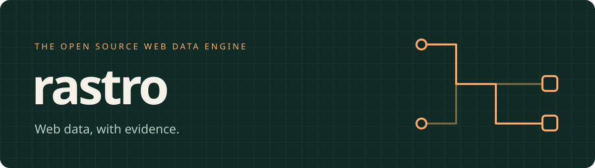

<p align="center">
  
</p>

<p align="center">
  <a href="https://github.com/rave-vipx/rastro/actions/workflows/ci.yml"></a>
  <a href="https://www.python.org/downloads/"></a>
  <a href="LICENSE"></a>
  
</p>

<p align="center">
  <a href="https://rave-vipx.github.io/rastro/">Documentation</a> ·
  <a href="docs/roadmap.md">Roadmap</a> ·
  <a href="CONTRIBUTING.md">Contributing</a> ·
  <a href="https://github.com/rave-vipx/rastro/issues">Issues</a>
</p>

Rastro is a Python library for turning web content into **validated records with field-level provenance**. Define your Pydantic schema, supply a declarative recipe, and inspect exactly what was extracted, rejected, or missing.

The long-term goal is reliable, continuously updated web datasets. We are building that engine incrementally, starting with deterministic extraction and explicit quality signals.

> **Development preview — v0.1 is in progress.** Rastro extracts supplied HTML or permitted HTTP sources using JSON-LD or CSS recipes. HTTP is an optional extra with destination controls, robots enforcement, and bounded asynchronous execution. SQLite recipe memory reuses validated strategies across restarts. Optional local Ollama assistance proposes recipes within strict budgets; every candidate is validated before activation. No PyPI release has been published by this project.

## Why Rastro?

- **A schema is the contract.** Pydantic checks required fields, ranges, types, and your own validators.
- **Errors stay visible.** Empty, invalid, ambiguous, partially valid, and successful results are different outcomes.
- **Every observed field has a source.** Records carry the URL, timestamp, extraction path, method, and recipe version.
- **Runs locally.** The current engine needs neither an account nor a model, browser, or external service.
- **Builds on Scrapling.** Scrapling handles HTML parsing behind an adapter. Rastro handles validation, evidence, and result accounting.

The first [reproducible comparison](docs/comparison.md) finds equal extraction results against a competent Scrapling + Pydantic baseline, including a shared silent semantic error. Rastro adds provenance and orchestration at a latency cost; improved accuracy or maintenance cost has not been demonstrated.

## Try it in a minute

Install [uv](https://docs.astral.sh/uv/getting-started/installation/), then:

```bash
git clone https://github.com/rave-vipx/rastro.git
cd rastro
uv sync --locked
uv run rastro demo
```

The demo uses synthetic HTML and prints JSON containing `status: "success"`, one validated record, field evidence, and timings. All extraction happens offline.

## A complete extraction

```python
from decimal import Decimal
from pydantic import BaseModel, Field
from rastro import Outcome, Rastro, Recipe, Source


class Product(BaseModel):
    name: str = Field(min_length=1)
    price: Decimal = Field(ge=0, allow_inf_nan=False)


html = """
<script type="application/ld+json">
{"@type": "Product", "name": "Trail notebook", "offers": {"price": "12.50"}}
</script>
"""

result = Rastro().extract_html(
    html,
    source=Source(url="https://example.com/products", locale="en-US"),
    schema=Product,
    recipe=Recipe(
        strategy="jsonld",
        item_type="Product",
        fields={"name": "/name", "price": "/offers/price"},
    ),
)

if result.status == Outcome.SUCCESS:
    print(result.records[0].data.price)  # 12.50
    print(result.records[0].evidence["price"].locator)  # jsonld[0]#/offers/price
else:
    print(result.status, result.issues)
```

`Source.url` labels the supplied document; this method does not fetch it. JSON-LD mappings use JSON pointers. For ordinary HTML, use a CSS recipe:

```python
recipe = Recipe(
    strategy="css",
    record_selector="article.product",
    fields={"name": "h2::text", "price": "span::attr(data-price)"},
)
```

See the [getting started guide](docs/getting-started.md), [API contracts](docs/api.md), and [runnable example](examples/offline.py).

## Acquire a permitted source

Install the HTTP extra with `uv sync --extra http`, then create a client with
`Rastro.web(AcquisitionPolicy(allowed_hosts=("example.com",)))`. Its asynchronous
`extract` and `extract_many` methods use the same schema, recipe, validation and
evidence contracts. Hosts must be explicitly permitted; robots rules, redirects,
DNS destinations, request budgets, and server restrictions are checked.

See the [HTTP guide](docs/acquisition.md) for a complete example, defaults and limitations.
Run [the public demo-site example](examples/catalogue.py) twice with the same database
to exercise HTTP extraction and recipe reuse; see its [recorded results](docs/release-evidence.md).
The transport uses curl_cffi, Scrapling’s HTTP engine; the [ADR](docs/decisions/0002-policy-aware-acquisition.md) explains why DNS pinning requires its public API.

## Remember successful recipes

Supply `repository=SQLiteRecipeRepository("rastro-recipes.db")` to `Rastro` or
`Rastro.web`. After a successful extraction, omit `recipe` to reuse its validated
version. Source, schema, locale, timezone, template and region remain isolated.

Run `uv run python examples/memory.py` twice to see reuse across process restarts,
or read the [recipe memory guide](docs/memory.md) for versions, fallbacks and deletion.

## Discover a recipe, with optional local assistance

Use `Rastro(discover_recipes=True)` with `await extract_html_async(...)` to discover
exact-name JSON-LD and microdata mappings without a model. Run
`uv run python examples/intelligence.py` for a synthetic offline example.

For pages that need assistance, install the `ollama` extra and supply
`model=OllamaModel("your-installed-model")`. Deterministic extraction runs first;
Ollama proposes declarative mappings and Rastro validates source evidence and the
schema before remembering them. Calls, time, context, responses and concurrency are
bounded. See the [optional intelligence guide](docs/intelligence.md).

## What works today

| Capability | Status |
| --- | --- |
| Typed Python SDK, JSON-LD and CSS extraction | Available |
| Pydantic validation and per-field provenance | Available |
| Explicit outcomes, input budgets, JSON logs and processing timings | Available |
| Offline CLI demo, diagnostics, recipe validation | Available |
| Optional HTTP acquisition, source policies and bounded async batches | Available |
| SQLite recipe storage and deterministic reuse | Available |
| Opt-in JSON-LD/microdata discovery and bounded local Ollama recipe generation | Available; live-model quality evidence pending |
| Controlled repair and drift monitoring | Planned for v0.2 |
| Continuous synchronization | Planned for v0.3 |
| Studio / community recipe Hub | Planned for v0.4 / v0.5 |

## Contribute

Start with [CONTRIBUTING.md](CONTRIBUTING.md) and the [milestone plan](docs/roadmap.md). Bug reports with a small **synthetic** HTML fixture are especially useful. Public API changes should include a concrete example and a link to the relevant requirement in the [master specification](RASTRO_MASTER_SPEC.md).

```bash
uv sync --locked --group docs
uv run ruff check .
uv run ruff format --check .
uv run mypy
uv run pytest
uv run --group docs mkdocs build --strict
```

Tests block network sockets and require at least 90% branch-aware coverage. CI also builds and installs the package and audits dependencies. See [SECURITY.md](SECURITY.md) for private vulnerability reporting.

## License

[Apache License 2.0](LICENSE). The package distribution is provisionally named `rastro-engine`; Python imports use `rastro`. Registry naming and dependency-license review remain release gates. No affiliation with other similarly named projects is implied.
