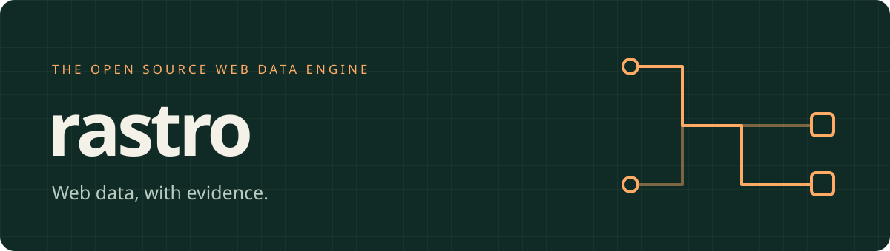

<p align="center">
  
</p>

<p align="center">
  <a href="https://github.com/rave-vipx/rastro/actions/workflows/ci.yml"></a>
  <a href="https://www.python.org/downloads/"></a>
  <a href="LICENSE"></a>
  
</p>

<p align="center">
  <a href="https://rave-vipx.github.io/rastro/">Documentation</a> ·
  <a href="docs/roadmap.md">Roadmap</a> ·
  <a href="CONTRIBUTING.md">Contributing</a> ·
  <a href="https://github.com/rave-vipx/rastro/issues">Issues</a>
</p>

**An event agenda that keeps itself updated when the source pages change.**

Rastro turns web pages into validated records with field-level provenance, loads them into a SQLite dataset, and repairs its own extraction recipes when a page changes. The engine is generic: fields and rules live in the [example job](examples/uy-dance-agenda/), not in the library.

> **v0.3.0, not published.** Nothing is on PyPI; install from source.

## What works today

- Live agenda (2026-11-08): 4 sources (SODRE, Sala Zitarrosa, Magnolio Sala, Tickantel), 54 records, 52 upcoming, spot-check 10/10, second run created 0. 8 of 52 rows are dance by keyword rule. See the [pilot](docs/pilot/uy-dance-agenda-v03.md).
- Repair suite (synthetic pages modeled on real ones): structural breakages repaired automatically 5/11 before, 10/11 now (`jsonld_key_moved` still rejected), 0 wrong recipes promoted. Data traps: 6 held by the consistency gate, 2 rejected, 4 no candidates; silent wrong data 5 to 0. Not yet proven on a real live breakage.
- Agenda page: <https://rave-vipx.github.io/rastro/agenda/>, refreshed daily at 08:00 Montevideo once this code is on `main`.

## Limits

- Multi-date cards keep only the first date.
- Skipped sources: Passline and Entraste (robots rules), BNS and Sala del Museo (date split across nodes).
- Dance classification is a keyword rule.
- Model-assisted repair (Ollama, OpenAI-compatible) exists but is frozen, as are the sealed recovery corpus, Mock Lab and `benchmarks/product_task`.

## Drift and repair offline

The cut-2 demo uses a temporary copy of the dance sample, Mock Lab mutations and the
real CLI. It keeps all six dataset records while quarantining a repair below its
configured record threshold, promoting after that threshold is met, rolling back,
and rejecting valid sale dates used as event dates (DRIFT-001–006, REPAIR-001–006,
QUAL-005/006). No model, browser or network is needed.

```sh
UV_PYTHON=/opt/homebrew/bin/python3.12 uv run python examples/uy-dance-agenda/repair_demo.py
```

The clock is pinned to 2026-11-07; lowering `repair.min_records` from 5 to 4 shows
quarantine below the configured record threshold, then promotion once it is met.

Reproducible output (the script prints CLI commands and selected JSON fields):

```text
rastro job load job.json --drift
exit=0 status=success stale=0 drift=none,none fields=
Mock Lab: moved and renamed title nodes (seed=42)
rastro job load job.json --drift
exit=3 status=partial_success stale=1 drift=structural_drift,none fields=city,currency,performance_id,performers,price,starts_at,ticket_url,title,venue
rastro recipe repair job.json --source 1
exit=3 decisions=quarantine,reject consistency=consistent,not_assessed
Configured repair.min_records=4 (was 5)
rastro recipe repair job.json --source 1
exit=0 decisions=promote,reject consistency=consistent,not_assessed
rastro job load job.json --drift
exit=0 status=success stale=0 drift=structural_drift,none fields=performance_id,title
rastro recipe compare job.json --from-version 1 --to-version 4
exit=0 schema_version=1 versions=1->4 changed=title
rastro recipe rollback job.json --version 1
exit=0 state=active version=1
rastro job load job.json --drift
exit=0 status=success stale=0 drift=structural_drift,none fields=performance_id,title
Mock Lab: valid sale date placed in event-date paths (seed=42)
rastro recipe repair job.json --source 2
exit=1 decisions=reject,reject consistency=inconsistent,not_assessed
All assertions passed; temporary dataset retained 6 records; external spend=$0
```

Each repair also writes its full versioned JSON report inside the temporary sample.
See [repair configuration and limits](docs/repair.md).

## Why Rastro?

- **A schema is the contract.** Pydantic checks required fields, ranges, types, and your own validators.
- **Errors stay visible.** Empty, invalid, ambiguous, partially valid, and successful results are different outcomes.
- **Every observed field has a source.** Records carry the URL, timestamp, extraction path, method, and recipe version.
- **Runs locally.** The current engine needs neither an account nor a model, browser, or external service.
- **Builds on Scrapling.** Scrapling handles HTML parsing behind an adapter. Rastro handles validation, evidence, and result accounting.

The first [reproducible comparison](docs/comparison.md) finds equal extraction results against a competent Scrapling + Pydantic baseline, including a shared silent semantic error. Rastro adds provenance and orchestration at a latency cost; improved accuracy or maintenance cost has not been demonstrated.

## An agenda database in five minutes

From a checkout of the development branch, install with `uv sync --locked`.
You need Python 3.12+, [uv](https://docs.astral.sh/uv/getting-started/installation/),
SQLite's CLI and jq. Run from the repository root; a private temporary copy keeps
the synthetic sample reusable. These commands were run on 2026-11-07 in 2.55 seconds
with dependencies installed (installation time is additional). External spend: $0;
network requests and model calls: zero.

Validate → preview → load → repeat → change a source → query → inspect stale data → export:

```sh
DEMO=$(mktemp -d)
DEMO=$(cd "$DEMO" && pwd -P)
cp -R examples/uy-dance-agenda/sample "$DEMO/agenda"
uv run rastro job validate "$DEMO/agenda/job.toml" | jq -c '{valid, source_count}'
uv run rastro job preview "$DEMO/agenda/job.toml" --output json | jq -c '{written, status: .job.status, accepted: .job.records_accepted}'
uv run rastro job load "$DEMO/agenda/job.toml" | jq -c '{counts: [.sources[].counts], stale_sources}'
uv run rastro job load "$DEMO/agenda/job.toml" | jq -c '{counts: [.sources[].counts], stale_sources}'
cp "$DEMO/agenda/v2/"*.html "$DEMO/agenda/"
uv run rastro job load "$DEMO/agenda/job.toml" | jq -c '{counts: [.sources[].counts], stale_sources}'
sqlite3 "$DEMO/agenda/agenda.sqlite" < examples/uy-dance-agenda/queries/upcoming.sql
printf '<html>Source unavailable</html>\n' > "$DEMO/agenda/tickantel-evento.html"
# The mixed run intentionally returns exit 3; jq prints its stale-origin report.
uv run rastro job load "$DEMO/agenda/job.toml" | jq -c '{status: .job.status, stale_sources: [.stale_sources[] | {source_url, last_success, affected_records: (.affected_keys | length)}]}'
uv run rastro dataset status "$DEMO/agenda/agenda.sqlite" | jq -c '{data_trust, stale: [.stale_sources[] | {source_url, last_success, affected_records: (.affected_keys | length)}]}'
uv run rastro dataset export "$DEMO/agenda/agenda.sqlite" --format jsonl > "$DEMO/agenda.jsonl"
wc -l < "$DEMO/agenda.jsonl"
```

Actual stdout (observation times vary; the fixed events stop being upcoming after
November 2026):

```text
{"valid":true,"source_count":2}
{"written":false,"status":"success","accepted":7}
{"counts":[{"created":4,"updated":0,"unchanged":0,"missing":0,"uncertain":0},{"created":2,"updated":0,"unchanged":1,"missing":0,"uncertain":0}],"stale_sources":[]}
{"counts":[{"created":0,"updated":0,"unchanged":4,"missing":0,"uncertain":0},{"created":0,"updated":0,"unchanged":3,"missing":0,"uncertain":0}],"stale_sources":[]}
{"counts":[{"created":0,"updated":1,"unchanged":3,"missing":0,"uncertain":0},{"created":0,"updated":1,"unchanged":2,"missing":0,"uncertain":0}],"stale_sources":[]}
2026-11-20T20:30:00-03:00|Candombe de Invierno|Auditorio Nelly Goitiño|2026-11-07T20:35:08.627915Z
2026-11-21T20:30:00-03:00|Candombe de Invierno|Auditorio Nelly Goitiño|2026-11-07T20:35:08.627296Z
2026-11-26T20:00:00-03:00|Gala Anual 2026: Área Tango y Milonga|Auditorio Nelly Goitiño|2026-11-07T20:35:08.627915Z
2026-11-26T20:00:00-03:00|Gala Anual 26: Tango y Milonga|Auditorio Nelly Goitiño|2026-11-07T20:35:08.627296Z
2026-11-28T21:00:00-03:00|Suite del Río de la Plata|Auditorio Nacional Adela Reta|2026-11-07T20:35:08.627296Z
2026-11-28T21:00:00-03:00|Suite del Río de la Plata|Auditorio Nacional Adela Reta|2026-11-07T20:35:08.627915Z
{"status":"partial_success","stale_sources":[{"source_url":"https://tickantel.com.uy/ng/espectaculo/9900102/gala-anual-2026-area-tango-y-milonga","last_success":"2026-11-07T20:35:08.627915Z","affected_records":3}]}
{"data_trust":"untrusted_source_data","stale":[{"source_url":"https://tickantel.com.uy/ng/espectaculo/9900102/gala-anual-2026-area-tango-y-milonga","last_success":"2026-11-07T20:35:08.627915Z","affected_records":3}]}
       6

```

Seven observations become six records, including one exact identity with two
origins. The second load creates none; the changed pages update both Suite origins
in place. The source-outage run returns exit 3 (partial success); the pipeline above
shows its JSON report through jq. Three origins become stale and all six records
remain available. The SQL deliberately includes retained records; your application
can use status and per-origin observation times to choose a freshness policy.

To use another source, edit `[[sources]]` in the copied job: a local page uses
`kind = "file"`, `path`, `url` and its declarative `recipe`; a live URL also needs
the [HTTP policy](docs/jobs.md). Pick another field by changing `[[fields]]`, its
recipe selector/pointer, and the `[dataset].approve` list (omit that list to approve
all declared fields). Only observed fields are saved. Choose identity once for a
new dataset; never change it in place. The sample's stable performance IDs are
synthetic demonstration data, not IDs asserted to exist on the live sites.

Connect an application with [the shipped SQL](examples/uy-dance-agenda/queries/upcoming.sql)
or the exported JSONL: each line includes values, field provenance, observation
times, origins and `data_trust: untrusted_source_data`. Both Suite records retain
uncertain-match warnings for review; differing Gala titles remain separate.
See [dataset semantics and limits](docs/dataset.md) and the [pilot obstacles](docs/pilot/uy-dance-agenda.md).

## A complete extraction

```python
from decimal import Decimal
from pydantic import BaseModel, Field
from rastro import JsonLdRecipe, Outcome, Rastro, Source


class Product(BaseModel):
    name: str = Field(min_length=1)
    price: Decimal = Field(ge=0, allow_inf_nan=False)


html = """
<script type="application/ld+json">
{"@type": "Product", "name": "Trail notebook", "offers": {"price": "12.50"}}
</script>
"""

result = Rastro().extract_html(
    html,
    source=Source(url="https://example.com/products", locale="en-US"),
    schema=Product,
    recipe=JsonLdRecipe(
        item_type="Product",
        fields={"name": "/name", "price": "/offers/price"},
    ),
)

if result.status == Outcome.SUCCESS:
    print(result.records[0].data.price)  # 12.50
    print(result.records[0].evidence["price"].locator)  # jsonld[0]#/offers/price
else:
    print(result.status, result.issues)
```

`Source.url` labels the supplied document; this method does not fetch it. JSON-LD mappings use JSON pointers. For ordinary HTML, use a CSS recipe:

```python
from rastro import CssRecipe

recipe = CssRecipe(
    record_selector="article.product",
    fields={"name": "h2::text", "price": "span::attr(data-price)"},
)
```

See the [getting started guide](docs/getting-started.md), [API contracts](docs/api.md), and [runnable example](examples/offline.py).

## Acquire a permitted source

Install the HTTP extra with `uv sync --extra http`, then create a client with
`Rastro.web(AcquisitionPolicy(allowed_hosts=("example.com",)))`. Its asynchronous
`extract` and `extract_many` methods use the same schema, recipe, validation and
evidence contracts. Hosts must be explicitly permitted; robots rules, redirects,
DNS destinations, request budgets, and server restrictions are checked.

See the [HTTP guide](docs/acquisition.md) for a complete example, defaults and limitations.
Run [the public demo-site example](examples/catalogue.py) twice with the same database
to exercise HTTP extraction and recipe reuse; see its [recorded results](docs/release-evidence.md).
The transport uses curl_cffi, Scrapling’s HTTP engine; the [ADR](docs/decisions/0002-policy-aware-acquisition.md) explains why DNS pinning requires its public API.

## Remember successful recipes

Supply `repository=SQLiteRecipeRepository("rastro-recipes.db")` to `Rastro` or
`Rastro.web`. After a successful extraction, omit `recipe` to reuse its validated
version. Source, schema, locale, timezone, template and region remain isolated.

Run `uv run python examples/memory.py` twice to see reuse across process restarts,
or read the [recipe memory guide](docs/memory.md) for versions, fallbacks and deletion.

## Discover a recipe, with optional local assistance

Use `Rastro(discover_recipes=True)` with `await extract_html_async(...)` to discover
exact-name JSON-LD and microdata mappings without a model. Run
`uv run python examples/intelligence.py` for a synthetic offline example.

For pages that need assistance, install the `ollama` extra and supply
`model=OllamaModel("your-installed-model")`. Deterministic extraction runs first;
Ollama proposes declarative mappings and Rastro validates source evidence and the
schema before remembering them. Calls, time, context, responses and concurrency are
bounded. See the [optional intelligence guide](docs/intelligence.md).

## Contribute

Start with [CONTRIBUTING.md](CONTRIBUTING.md) and the [milestone plan](docs/roadmap.md). Bug reports with a small **synthetic** HTML fixture are especially useful. Public API changes should include a concrete example and a link to the relevant requirement in the [master specification](RASTRO_MASTER_SPEC.md).

```bash
uv sync --locked --group docs
uv run ruff check .
uv run ruff format --check .
uv run mypy
uv run pytest
uv run --group docs mkdocs build --strict
```

Tests block network sockets and require at least 90% branch-aware coverage. CI also builds and installs the package and audits dependencies. See [SECURITY.md](SECURITY.md) for private vulnerability reporting.

## License

[Apache License 2.0](LICENSE). The package distribution is provisionally named `rastro-engine`; Python imports use `rastro`. Registry naming and dependency-license review remain release gates. No affiliation with other similarly named projects is implied.
