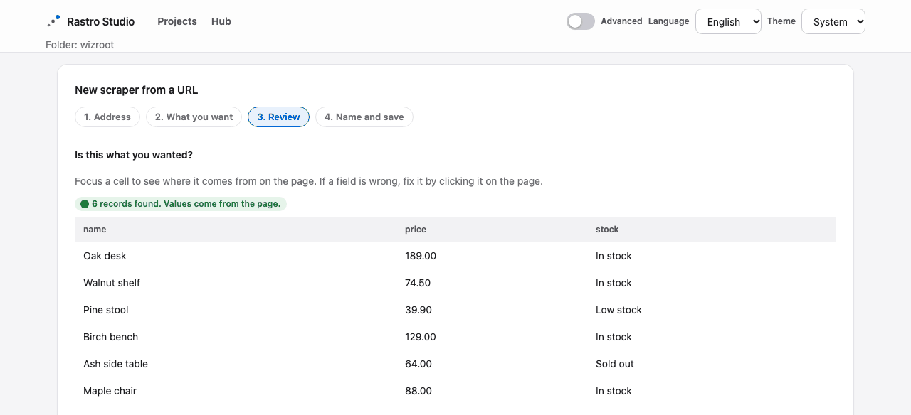
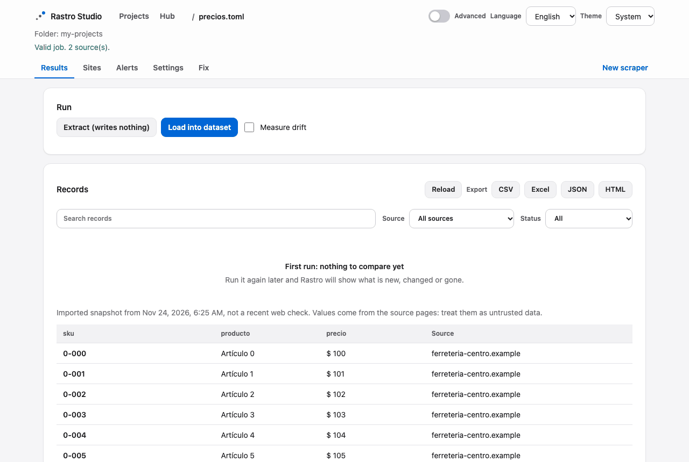
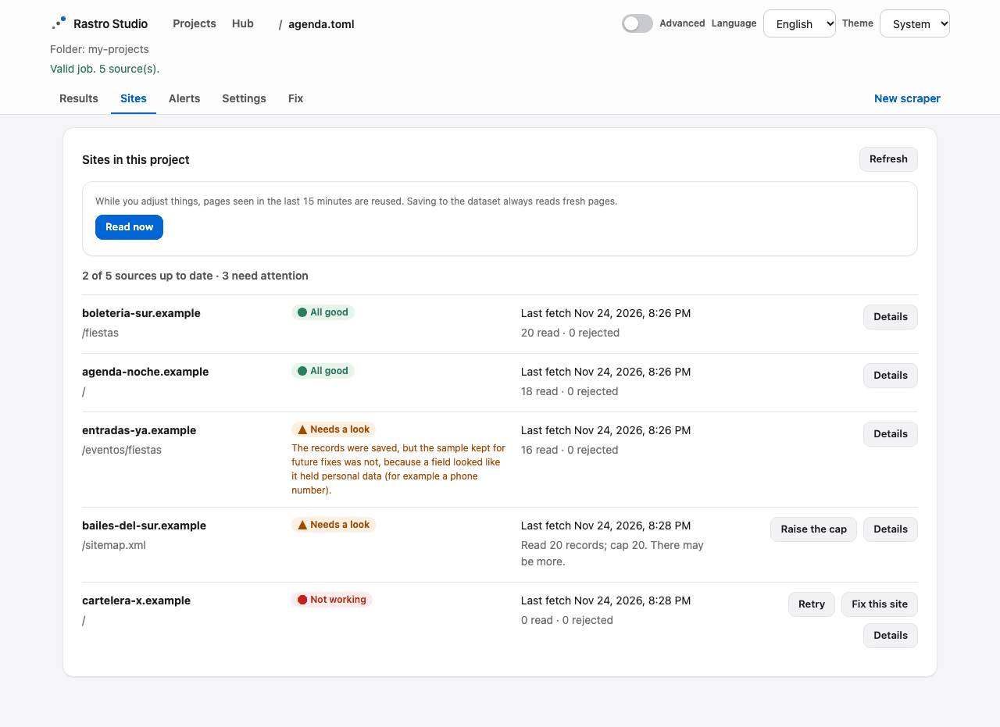

<p align="center">
  
</p>

<p align="center">
  <a href="https://github.com/rave-vipx/rastro/actions/workflows/ci.yml"></a>
  <a href="https://www.python.org/downloads/"></a>
  <a href="https://github.com/rave-vipx/rastro/blob/main/LICENSE"></a>
  <a href="https://pypi.org/project/rastro-engine/"></a>
</p>

<p align="center">
  <a href="https://rave-vipx.github.io/rastro/">Documentation</a> ·
  <a href="https://rave-vipx.github.io/rastro/capabilities/">Capabilities</a> ·
  <a href="https://rave-vipx.github.io/rastro/configuration/">Configuration</a> ·
  <a href="https://rave-vipx.github.io/rastro/stability/">Stability policy</a> ·
  <a href="https://github.com/rave-vipx/rastro/blob/main/CONTRIBUTING.md">Contributing</a> ·
  <a href="https://github.com/rave-vipx/rastro/issues">Issues</a>
</p>

Rastro is a Python scraping library where AI does the hard part once and a stored recipe
does the rest.

**AI writes the scraper once, recipes keep it running.**

## The recipe loop

1. **AI studies the site once.** A local or connected model looks at the page and proposes
   a recipe: selectors, field mappings and, when needed, page steps. Rastro keeps it only if
   it extracts valid records from the real page.
2. **Recipes run without AI.** Later runs on that site use the stored recipe: no model call,
   and the same validation and field provenance every time.
3. **Rastro notices when the site changes.** Drift and failed runs show up in Studio and can
   notify you by email, Slack, Telegram or a webhook.
4. **AI repairs it through gates.** Rastro proposes a repair, with or without a model, and a
   candidate replaces the recipe only after it passes gates that refuse silent wrong data.

Rastro also works with no model at all: give one example value per field and it builds the
recipe deterministically. See [Bring your own AI](https://rave-vipx.github.io/rastro/ai/),
[drift](https://rave-vipx.github.io/rastro/drift/) and
[recipe repair](https://rave-vipx.github.io/rastro/repair/).

## Five minutes

```sh
pip install "rastro-engine[studio,http]"
mkdir my-scrapers && rastro studio --root my-scrapers
```

Open the loopback URL printed in the terminal, choose **Start from a URL**, paste a page you
have permission to scrape, name the fields you want and give one example value for each (with
a model, names alone are enough). Studio shows the records it found before anything is saved:

<p align="center">
  
</p>

Name the project, save it, and press **Load into dataset**. Load again later to update the
same records, and export them as CSV, Excel, JSON or HTML from the same page:

<p align="center">
  
</p>

Every site in a project has its health in plain words, with **Retry** and **Fix this site**
when it stops working:

<p align="center">
  
</p>

See the [Studio guide](https://rave-vipx.github.io/rastro/studio/). The screenshots use
synthetic `.example` sites.

### The same from Python

Run a saved project and read what it stored, with provenance, from your own code:

```python
import rastro

rastro.load_job_file("shop.toml")  # fetch the sites, extract, update the dataset
for record in rastro.read_records("shop.toml").records:
    print(record.key, record.fields, record.origins)
```

Or extract typed records from one page with a Pydantic model:

```python
from typing import Annotated, ClassVar
from pydantic import BaseModel, HttpUrl
import rastro


class Offer(BaseModel):
    __records__: ClassVar[str] = "li.job"
    title: Annotated[str, rastro.css("h3::text")]
    url: Annotated[HttpUrl, rastro.css("a::attr(href)")]


html = '<ul><li class="job"><h3>Senior Dev</h3><a href="https://acme.example/jobs/1">Apply</a></li></ul>'
result = rastro.scrape(html, Offer, url="https://acme.example/careers")
for offer in result.items:  # validated Offer instances
    print(offer.title, offer.url)
print(result.status, result.issues)
```

The target may be an HTML string, a `pathlib.Path`, or an `https://` URL (needs the `http`
extra). Every value carries its source URL, observation time, selector, method and recipe
version. Missing, invalid and ambiguous data are explicit outcomes, never a silent empty list.
See the [quickstart](https://rave-vipx.github.io/rastro/quickstart/),
[reading results](https://rave-vipx.github.io/rastro/reading-results/) and the
[API reference](https://rave-vipx.github.io/rastro/api/).

## Use it from your AI agent

Made for building with a coding agent: the agent adds Rastro to the project, and you
configure it and watch the results in Studio.

```sh
rastro init --agent claude     # or codex, generic: tells the agent what Rastro already does
pip install "rastro-engine[mcp]"
claude mcp add rastro -- rastro mcp --root .
```

`rastro init` writes Rastro's capability list into the project's agent instructions, so the
agent calls the public API, the JSON command line or the MCP tools instead of rebuilding
pagination, crawling or repair. Over MCP the agent can be the model: it proposes recipes and
Rastro verifies them. See [Rastro for AI agents](https://rave-vipx.github.io/rastro/ai-agents/),
the [MCP server](https://rave-vipx.github.io/rastro/mcp/) and
[`llms.txt`](https://github.com/rave-vipx/rastro/blob/main/llms.txt).

## What it handles

- **Blocked pages.** A refused source climbs an automatic ladder (browser impersonation, a
  browser, a stealth browser, challenge solving) as far as your grants allow, and the recipe
  remembers the lowest level that worked. Robots refusals and rate limits never climb.
  [The acquisition ladder](https://rave-vipx.github.io/rastro/egress/#the-acquisition-ladder).
- **JavaScript and clicks.** Render pages in a browser, and reach records behind a "load
  more" button, a tab or a form with page steps: a model finds them once, they are stored as
  declarative steps, and later runs replay them without a model.
  [JavaScript pages](https://rave-vipx.github.io/rastro/acquisition/#javascript-pages),
  [page steps](https://rave-vipx.github.io/rastro/page-steps/).
- **APIs behind pages.** Read the JSON a page loads instead of its markup, while robots,
  pacing and provenance stay the page's.
  [Recipes from the site's own data](https://rave-vipx.github.io/rastro/network-recipes/).
- **Nested records.** Lists and objects as typed fields.
  [Field contracts](https://rave-vipx.github.io/rastro/fields/#lists-and-objects).
- **Whole-site crawls.** Follow listing-to-detail links or a sitemap, or crawl a site with a
  time budget instead of a page cap and resume where it stopped.
  [Crawling](https://rave-vipx.github.io/rastro/crawling/#unbounded-crawls),
  [spider](https://rave-vipx.github.io/rastro/jobs/#spider).
- **Proxies.** Your own proxies and rotation over them, opt-in, with every target still
  checked against the allowed hosts.
  [Proxies, rotation and blocked sources](https://rave-vipx.github.io/rastro/egress/).
- **Schedules and notifications.** A `[schedule]` block on the same job file, and email,
  Slack, Telegram or webhook alerts when a job needs attention.
  [Monitoring and alerts](https://rave-vipx.github.io/rastro/operations/).
- **Excel, CSV and JSON.** `rastro dataset export data.sqlite --format json|jsonl|csv|xlsx|html`,
  or the export buttons in Studio; SQLite by default, PostgreSQL optional.
  [Capabilities](https://rave-vipx.github.io/rastro/capabilities/),
  [datasets](https://rave-vipx.github.io/rastro/dataset/).

Fetching is opt-in and limited to hosts you allow; Rastro honours robots rules, paces
requests, and needs your explicit grant for stealth and proxies. It promises no invisibility.
See [HTTP acquisition](https://rave-vipx.github.io/rastro/acquisition/) and
[SECURITY.md](https://github.com/rave-vipx/rastro/blob/main/SECURITY.md).

## Models

Any model works through one interface, and none is required:

| You have | Spec | Page content leaves the machine? |
| --- | --- | --- |
| A local runtime (Ollama, LM Studio, llama.cpp, vLLM) | `ollama:<model>` or `http:<model>@http://127.0.0.1:<port>/v1` | No |
| An API key for a Chat Completions-compatible service | `http:<model>@<https url>` with `--allow-remote` | Yes, opt-in |
| A subscription's command-line tool | `command:<program>` with `--allow-remote` | Yes, opt-in |
| An agent driving Rastro over MCP | No model inside Rastro; the agent proposes | Under the agent's terms |
| Nothing | Example values per field; repair without a model | No |

`rastro model detect` lists local Ollama, LM Studio and llama.cpp servers. A model never
writes your data: it proposes, and Rastro runs the proposal on the real page, validates it
and gates it like any other candidate. The measured results, including where small local
models fall short, are in [Bring your own AI](https://rave-vipx.github.io/rastro/ai/#measured-results).

## Recipe hub

Start from someone else's recipe. Studio asks the shared hub when you enter a URL, and the
command line does the same:

```sh
rastro hub search https://shop.example/catalogue
rastro hub install ID --store recipes.sqlite
```

An installed recipe is only a candidate: it passes digest, selector-policy and offline-replay
checks, and serves only after it passes the promotion gate on your own page. Recipes are data
and cannot run code. The hub is a static Git repository; there are no accounts and no
Rastro-operated server, and you can host your own. See the
[recipe hub](https://rave-vipx.github.io/rastro/hub/).

## How it compares

| | Rastro | Scrapling + Pydantic by hand | Scrapy | BeautifulSoup |
| --- | --- | --- | --- | --- |
| Recipe proposed by a model, then run without one | Built in, verified | You write it | No | No |
| Typed, validated records | From your model or job | You wire it | Via items/pipelines | No |
| Field provenance (URL, selector, time, recipe version) | Built in | You write it | No | No |
| Explicit failure outcomes | Built in | You write it | Partly (errors, stats) | No |
| Repair when the site changes | Gated, with or without a model | Scrapling's adaptive relocation, ungated | No | No |
| Crawling | Bounded, or time-budgeted with resume | You write it | Yes, its core strength | No |
| Dataset with identity and stale tracking | Built in | You write it | Via pipelines | No |
| Speed on a single page | Slower (validation and evidence) | Faster | Fast | Varies by parser |

On the synthetic benchmark Rastro did not show better raw extraction accuracy than a
competent Scrapling + Pydantic baseline, and it was slower on every page because it validates
and keeps evidence. See the [comparison](https://rave-vipx.github.io/rastro/comparison/) and
the [AI repair evidence](https://rave-vipx.github.io/rastro/ai-evidence/).

Rastro fetches, renders and parses through engines behind strategy interfaces; Scrapling is
the engine today. See [engines](https://rave-vipx.github.io/rastro/engines/).

## Install

```sh
pip install rastro-engine                    # core: parse supplied HTML, no network
pip install "rastro-engine[http]"            # fetch permitted URLs
pip install "rastro-engine[studio]"          # local web UI
pip install "rastro-engine[browser]"         # JavaScript pages and page steps
pip install "rastro-engine[mcp]"             # MCP server for AI agents
pip install "rastro-engine[ollama]"          # local Ollama models
pip install "rastro-engine[openai]"          # any Chat Completions-compatible endpoint
pip install "rastro-engine[postgres]"        # PostgreSQL datasets
```

The package is `rastro-engine`; the import is `rastro`. Python 3.12 or newer. The core needs
no account, model, browser or external service.

## Links

- [Documentation](https://rave-vipx.github.io/rastro/) and the
  [configuration reference](https://rave-vipx.github.io/rastro/configuration/)
- [Stability policy](https://rave-vipx.github.io/rastro/stability/): Semantic Versioning for
  `rastro.__all__`, the CLI and its JSON, the job format and the recipe bundle format
- [Changelog](https://github.com/rave-vipx/rastro/blob/main/CHANGELOG.md)
- [Security policy](https://github.com/rave-vipx/rastro/blob/main/SECURITY.md)
- [Contributing](https://github.com/rave-vipx/rastro/blob/main/CONTRIBUTING.md): bug reports
  with a small synthetic HTML fixture are especially useful; tests run offline

Licensed under the [Apache License 2.0](https://github.com/rave-vipx/rastro/blob/main/LICENSE).
No affiliation with other similarly named projects is implied.
