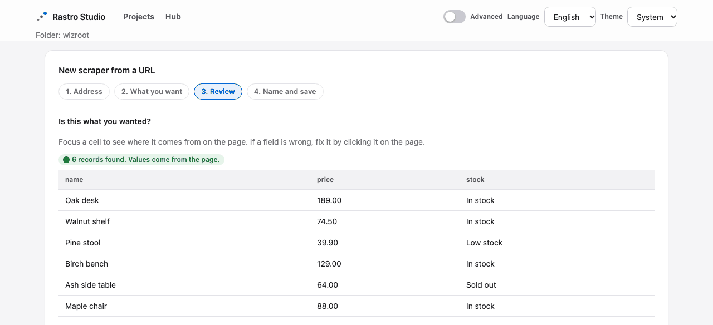

# Rastro

Rastro is a Python scraping library where AI does the hard part once and a stored recipe
does the rest. **AI writes the scraper once, recipes keep it running.**

1. **AI studies the site once.** A local or connected model proposes a recipe; Rastro keeps
   it only if it extracts valid records from the real page.
2. **Recipes run without AI.** Later runs use the stored recipe, with the same validation and
   field provenance every time.
3. **Rastro notices when the site changes**, in Studio and through notifications.
4. **AI repairs it through gates** that refuse silent wrong data.

No model is required: example values build a recipe deterministically, and repair also runs
without one.

## Start here

- [Five minutes with Studio](studio.md): paste a URL, review the records, load a dataset.
- [Run the offline example](getting-started.md) and the [quickstart](quickstart.md).
- [Use Rastro from an AI agent](ai-agents.md): `rastro init --agent`, the [MCP server](mcp.md) and the JSON command line.
- [Bring your own AI](ai.md): local Ollama or LM Studio, any API, a subscription CLI, or your MCP agent.
- [Read results with provenance](reading-results.md), and the [run report](run-report.md).

## What it handles

- [Blocked pages and the acquisition ladder](egress.md#the-acquisition-ladder), [proxies and rotation](egress.md).
- [JavaScript pages](acquisition.md#javascript-pages) and [page steps](page-steps.md) for clicks, tabs and forms.
- [Recipes from the site's own JSON](network-recipes.md).
- [Lists and nested objects](fields.md#lists-and-objects).
- [Crawling linked pages](crawling.md), including time-budgeted crawls that resume.
- [Schedules, notifications and monitoring](operations.md).
- [Datasets](dataset.md) and exports to CSV, Excel, JSON and HTML.
- [Recipe hub](hub.md): start from someone else's recipe.

## Reference

- [Capabilities](capabilities.md) and the [configuration reference](configuration.md).
- [API reference](api.md), [jobs](jobs.md), [drift](drift.md) and [recipe repair](repair.md).
- [Engines](engines.md) and the [architecture](architecture.md).
- [Comparison](comparison.md) and [AI repair evidence](ai-evidence.md).
- [Stability policy](stability.md).

## What the records mean

A schema defines what you accept. A recipe records where fields are found. Rastro validates
each candidate separately, keeps accepted records, and reports missing, ambiguous and invalid
inputs instead of disguising them as successful empty data. Evidence records the source URL,
observation time, locator, method and recipe version: it describes where a value came from,
not whether the source is truthful.

## Project resources

[Source code](https://github.com/rave-vipx/rastro) · [Contributing](https://github.com/rave-vipx/rastro/blob/main/CONTRIBUTING.md) · [Security policy](https://github.com/rave-vipx/rastro/blob/main/SECURITY.md)

Rastro is licensed under Apache 2.0 and builds on Scrapling and Pydantic.
